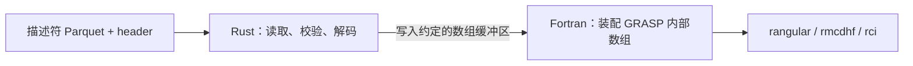

# rCSFs 3.0.0 描述符接入 GRASP 讨论记录

日期：2026-11-10（Asia/Singapore）。

本记录保存关于 rCSFs 3.0.0 描述符能否直接提供 GRASP 内部 CSF 数据、接口归属、Rust/Fortran 数据交换，以及降低编译依赖的六轮讨论。保留用户问题、助手回答和方案调整；工具输出与重复进度消息省略，源码引用改为仓库相对链接或工作区内相对路径。

**讨论结束时的建议**：在 `grasp-atomic-suite` 中提供预处理脚本，将已有描述符 Parquet 和 header 转为带版本的简单二进制文件，再由 suite 的 Fortran 输入模块读取并装配 GRASP 数组。该方案避免 suite 链接 rCSFs。前面讨论的 C ABI 直连是另一种方案，尚未实现；用户尚未要求实施其中任一方案。

## 1. 描述符是否可以直接给 GRASP 使用

**用户：**

> 看下现在的rcsfs库生成的描述符是否可以直接给grasp使用

**助手检查过程中的答复：**

我先检查 rCSFs 的描述符格式、恢复接口，以及 GRASP 实际读取的输入格式，确认能否直接使用、是否需要转换。

源码显示：当前 V2 描述符保留了恢复 CSF 所需的信息，但 GRASP 的输入入口仍读取文本 `rcsf.inp`，不能直接读取描述符 Parquet。我继续核对恢复过程与 GRASP 内部量子数表示的差异，并检查现有测试能验证到哪一层。

这一轮在最终答复前被下一轮澄清打断。后续讨论将“直接使用”的重点从文件输入格式调整为量子数的内部表示。

## 2. 3.0.0 的 sub_v 已改为 GRASP 状态表中的值

**用户：**

> 我指的是3.0.0版本的rcsfs，不是已经将sub_v改为了grasp中那个对照表中生成的值而不是实际csfs中的值

**助手：**

对，你说得对。**rCSFs 3.0.0 的 `sub{i}_v` 已经是 GRASP 状态表中的真实 seniority，可以对应 GRASP 内部的 seniority 字段。**我前面把“直接使用”理解成了读取 Parquet，偏离了你问的量子数表示。

源码对应关系很明确：

- rCSFs 通过 `physical_seniority(...)` 写入 `sub{i}_v`，包括 CSF 文本省略的 seniority；空壳、满壳为 `0`。见 [descriptor_v2.rs](../src/descriptor_v2.rs) 的 `write_feature_row` 和 [seniority.rs](../src/seniority.rs)。
- GRASP 的 `NTAB` 每项是 `(v, w, 2J+1)`；读取 CSF 后取得 `NU = NTAB(J)`，再存入 `JQSA(I,1,ICSF)`。**这里的 `NU` 就是新描述符 `sub_v` 对应的量。**对应工作区源码为 `grasp/src/lib/libmod/terms_C.f90` 和 `grasp/src/lib/lib9290/lodcsh2.f90`。

所以，在现有支持的态范围内，**可以编写接口直接将描述符装配为 GRASP 内部数组，不必先恢复成 CSF 文本。**但整个描述符还不能原样复制：

| 描述符字段 | 接入 GRASP 时的处理 |
| --- | --- |
| `sub_n` | 对齐轨道索引后写入占据数 |
| `sub_v` | 直接作为内部 seniority |
| `sub_2j` | 有效值转换成 `2J+1`；`-1` 表示文本省略，需要补全 |
| `sub_2k` | 补全省略的耦合，按开放壳层顺序装配，再转换成 `2K+1` |
| `total_two_j`、`parity` | 按 GRASP 的表示组合为 `(2J+1) × parity` |

还要用 header 补齐 core 和轨道信息。**3.0.0 已解决你指出的 `v` 语义问题，剩下的是直接加载及数组装配接口。**

本次结论来自源码核对；尚未完成运行验证，尝试的 Rust 测试因本地缺少离线依赖而未启动。

## 3. 是否只需少量转换就能提供 GRASP 所需数据

**用户：**

> 也就是说只要对描述符做一点修改，就可以实现grasp中需要的数据

**助手：**

是的。**对于 GRASP 需要的 CSF 占据数、壳层量子数和耦合数据，3.0.0 描述符加配套 header 已具备主要信息，可以通过一层确定性的转换生成内部数组。**

需要完成的主要是：

- **占据数和 seniority**：对齐轨道索引后直接填入。
- **角动量**：将有效的 `2J/2K` 转成 GRASP 的 `2J+1/2K+1`。
- **省略项**：补全 `-1` 表示的省略值，并按 GRASP 的开放壳层顺序组织耦合。
- **公共信息**：从 header 补齐 core、轨道表和分块信息。

建议增加一个 **`descriptor → GRASP 内部数组` 转换接口**，保留现有描述符格式。这样可以跳过“恢复文本 → GRASP 再解析文本”，也不影响现有 ML 和文本恢复功能。

**数据表示上的距离已经很小；实际接入仍要验证新接口生成的数组与 GRASP 原文本读取路径逐项一致。**这里说的是 CSF 数据，完整计算所需的径向波函数、核参数等仍由原流程提供。

## 4. 接口放在 rCSFs 还是 grasp-atomic-suite

**用户选中的上文：**

> 建议增加一个 descriptor → GRASP 内部数组 转换接口

**用户：**

> 这个接口写到rcsfs中还是grasp-atomic-suite中比较好

**助手：**

**建议把“装配 GRASP 内部数组”的接口放在 `grasp-atomic-suite`，描述符读取与解码继续由 `rCSFs` 负责。**

这两部分的职责可以明确分开：

| 所在仓库 | 负责内容 |
| --- | --- |
| **rCSFs** | 读取 Parquet/header，校验版本和元数据，解码描述符，补全省略的物理量，提供与求解器无关的 CSF 数据 |
| **grasp-atomic-suite** | 转换为 `2J+1` 等内部表示，组织 `IQA/JQSA/JCUPA`，处理轨道索引、数组分配、分块和 MPI |

原因是 **GRASP 数组的布局和生命周期由 suite 决定**。例如现有 `grasp-atomic-suite/src/lib/lib9290/lodcsl.f90` 按 `NNNW` 和 CSF 数分配这些数组；这些容量、全局状态和 MPI 约定不适合成为 rCSFs 的接口约束。另一方面，V2 格式及 seniority 规则已经集中在 rCSFs，继续复用能避免两套实现发生偏差。

具体落地时，我建议：

1. **rCSFs 提供通用的分块读取接口**，保留现有描述符格式；若要由 Fortran 直接调用，再增加可选的、无 Python 依赖的 C ABI。
2. **suite 的共享输入层增加适配模块**，让 `rangular`、`rmcdhf`、`rci` 复用，逐步接入各程序。
3. 用同一份 CSF 对比两条输入路径，逐项验证量子数数组、轨道顺序和 block 信息一致。

这样以后描述符格式变化由 rCSFs 处理，GRASP 内部结构变化由 suite 处理。

## 5. Fortran 如何接收 Rust 处理后的数据

**用户：**

> fortran程序如何读取rcsfs这个rust程序读取或者说处理过后的数据？

**助手：**

**可以把 rCSFs 的 Rust 核心编译成库，让 Fortran 通过 C ABI 调用它，直接接收内存中的数组。**两部分运行在同一个进程里。C ABI 是函数调用约定，不需要额外编写一个 C 程序。见 [Rust 官方链接说明](https://doc.rust-lang.org/reference/linkage.html)。



具体可以这样设计：

1. **Fortran 调用 Rust 打开数据。**Rust 读取文件元数据，返回一个句柄，以及轨道数、CSF 数和分块信息。
2. **Fortran 分配接收数组。**例如占据数、seniority、壳层角动量和耦合数组。把数组的地址与容量传给 Rust。
3. **Rust 按批读取、处理并填入数组。**Fortran 看到的就是自己分配的数组中的新数据，无需再解析 CSF 文本。大数据可以分批传递。
4. **suite 的适配模块装配内部状态。**完成 `2J → 2J+1`、core 补齐、耦合排列，以及 `IQA/JQSA/JCUPA` 的写入。
5. **Fortran 关闭 Rust 句柄。**Fortran 管理接收数组，Rust 管理文件读取器和内部临时内存，释放职责清楚。

拟议接口可以是下面这样，**这些名称只是设计示意，目前尚未实现**：

```text
rcsfs_open(...)        → 打开文件，返回句柄
rcsfs_get_info(...)    → 查询轨道、CSF、block 信息
rcsfs_read_batch(...)  → 将一批 CSF 数据填入调用方数组
rcsfs_close(...)       → 释放读取器
```

语言之间的连接方式是：

- Rust 用 `extern "C"` 导出函数。
- Fortran 用 `ISO_C_BINDING` 和 `bind(C)` 声明对应接口。
- 参数使用明确宽度的整数、指针和长度；数组排列顺序也必须约定好。Fortran 的第一维在内存中连续。见 [GNU Fortran 官方说明](https://gcc.gnu.org/onlinedocs/gfortran/Interoperability-with-C.html)。

例如，约定数组为 `occupation(nshell, ncsf)`，Rust 填写其连续缓冲区时，就采用 `shell + nshell * csf` 的零基偏移。量子数可以用一字节整数，CSF 数量和索引则保留宽整数。

当前仓库已经有部分基础：[rCSFs 的构建配置](../Cargo.toml)包含 `staticlib` 和 `cdylib`；`grasp-atomic-suite/src/lib/lib9290/suite_system.f90` 已经使用 Fortran 的 C 互操作机制。需要新增的是 **rCSFs 的数据导出 C 接口，以及 suite 对应的 Fortran 接收和装配模块**；供 Fortran 链接的 Rust 库应采用不启用 Python 的构建配置。

## 6. 避免 rCSFs 编译依赖的独立读取方案

**用户：**

> 那是否可以直接在grasp-atomic-suite中写这个读取代码，rcsfs有点“重”了，编译很花时间

**助手：**

**可以。考虑到你希望减少编译依赖，我更建议把读取和 GRASP 数组装配都放在 `grasp-atomic-suite`，不链接 rCSFs。**

需要区分两件事：**描述符数值的解释比较简单，Parquet 文件本身的解码比较复杂。**当前文件涉及列块、元数据、字典编码和压缩，不能直接用 Fortran `READ` 当作连续 Int8 数组读取。见 [Parquet 格式说明](https://parquet.apache.org/docs/file-format/)。

比较轻量的实现方式是：

```text
已有描述符 Parquet + header
          ↓ suite 中的预处理脚本
简单的二进制数据文件
          ↓ suite 中的 Fortran 读取模块
IQA / JQSA / JCUPA
```

具体分工：

- **预处理脚本**：使用 Python/PyArrow 分批读取 Parquet，校验 V2 格式，将原始描述符、轨道表和 block 信息写入二进制文件。无需导入或编译 rCSFs。
- **Fortran 读取模块**：用 `access='stream', form='unformatted'` 读取，再完成省略量补全、角动量表示转换及内部数组装配。
- **文件契约**：明确版本、字节序、整数宽度、数组顺序和分块位置，保留原 CSF 顺序。

这样，**GRASP 的编译和计算运行都可以只依赖 Fortran 侧原有环境**；Python 只用于数据准备，可以在另一台机器上完成。代价是增加一次转换和一份中间文件。

如果要求 **Fortran 直接打开现有 `.parquet` 文件**，也可以实现，但需要引入 Parquet 读取库或自行实现其格式，依赖和维护成本就会上升。对于你现在“减少编译时间”的目标，我会优先采用上述二进制输入方案，并用原文本读取路径验证数组逐项一致。

## 7. 源码依据和验证边界

### 源码基线

讨论所用的 rCSFs 源码为 **3.0.0，提交 `373cc7f52b4de553a70411c10cf2aab4b49c0c09`**。归档时工作区的 GRASP 参考仓库 HEAD 为 `488e875d1a7ec631baf4ad33682798bc795b7435`，grasp-atomic-suite HEAD 为 `e229657d8a32b851da9c130928545bcb3ac209f1`。这些版本用于定位讨论背景，不表示不同程序和全部支持态均已完成兼容性测试。

| 需要核对的内容 | 源码或说明 |
| --- | --- |
| V2 的 `4M+2` 布局、Int8、`-1`、角动量上界和必需元数据 | [descriptor_schema.rs](../src/descriptor_schema.rs) |
| 描述符编码、物理 seniority 写入和解码 | [descriptor_v2.rs](../src/descriptor_v2.rs) |
| 真实 seniority 与 CSF 打印标签之间的映射 | [seniority.rs](../src/seniority.rs) |
| Parquet 恢复入口、header 校验和 Python 绑定 | [csfs_descriptor.rs](../src/csfs_descriptor.rs)、[Python API](../rcsfs/__init__.py) |
| 生成描述符的压缩、字典编码及 Parquet 物理 INT32 存储说明 | [csf_output.rs](../src/csf_output.rs) |
| seniority 和文本恢复测试定义 | [seniority_test.py](../tests/seniority_test.py) |
| Int8 和非法角动量测试定义 | [descriptor_i8_test.py](../tests/descriptor_i8_test.py) |
| 原生 CLI 描述符往返测试定义 | [native_cli_test.rs](../tests/native_cli_test.rs) |
| GRASP 状态表及读取后的 `NU`、`JQSA`、`JCUPA` | 工作区 `grasp/src/lib/libmod/terms_C.f90`、`grasp/src/lib/lib9290/lodcsh2.f90` |
| suite 数组分配和 C 互操作示例 | 工作区 `grasp-atomic-suite/src/lib/lib9290/lodcsl.f90`、`grasp-atomic-suite/src/lib/lib9290/suite_system.f90` |

GRASP 和 suite 的上述路径属于独立仓库，仅作为定位依据；本记录未复制它们的源码，也不要求 rCSFs 的维护测试依赖它们。

### 已确认与待验证

- **源码已确认**：3.0.0 使用物理 seniority；J/K 通道仍保留文本省略标记；已有描述符到 CSF 文本的恢复实现。对应格式说明见 [README](../README.md) 和 [3.0.0 修改记录](CHANGELOG.md)。
- **设计建议，尚未实现**：通用 C ABI、suite 描述符适配层、预处理二进制文件格式及读取器。二进制格式的具体布局和版本协议尚未确定。
- **范围限制**：直接提供数据的判断针对当前支持态范围内的普通 CSF 占据、量子数和耦合信息，不代表已覆盖所有 GRASP 变体、额外简并标签或 CSFG 专用结构。径向波函数、核参数等仍由原计算流程提供。
- **本次未完成运行验证**：讨论中尝试从 rCSFs 根目录运行下列相关测试，因离线缓存缺少 `ahash v0.8.12` 而在构建前失败，不能报告为测试通过。未启动 GRASP 科学计算。

```sh
cargo test --offline --locked --no-default-features --features cli \
  --test descriptor_i8_test --test csfs_descriptor_test \
  --test native_cli_test descriptor
```

后续实施时，应先固定输入契约并实现小型读取样例，再将新路径产生的占据数、seniority、角动量、耦合数组、轨道次序和 block 信息与原文本读取路径逐项比较。性能和完整计算结果需在接口实现后另行验证，本讨论未给出编译时间或运行加速的测量结论。
